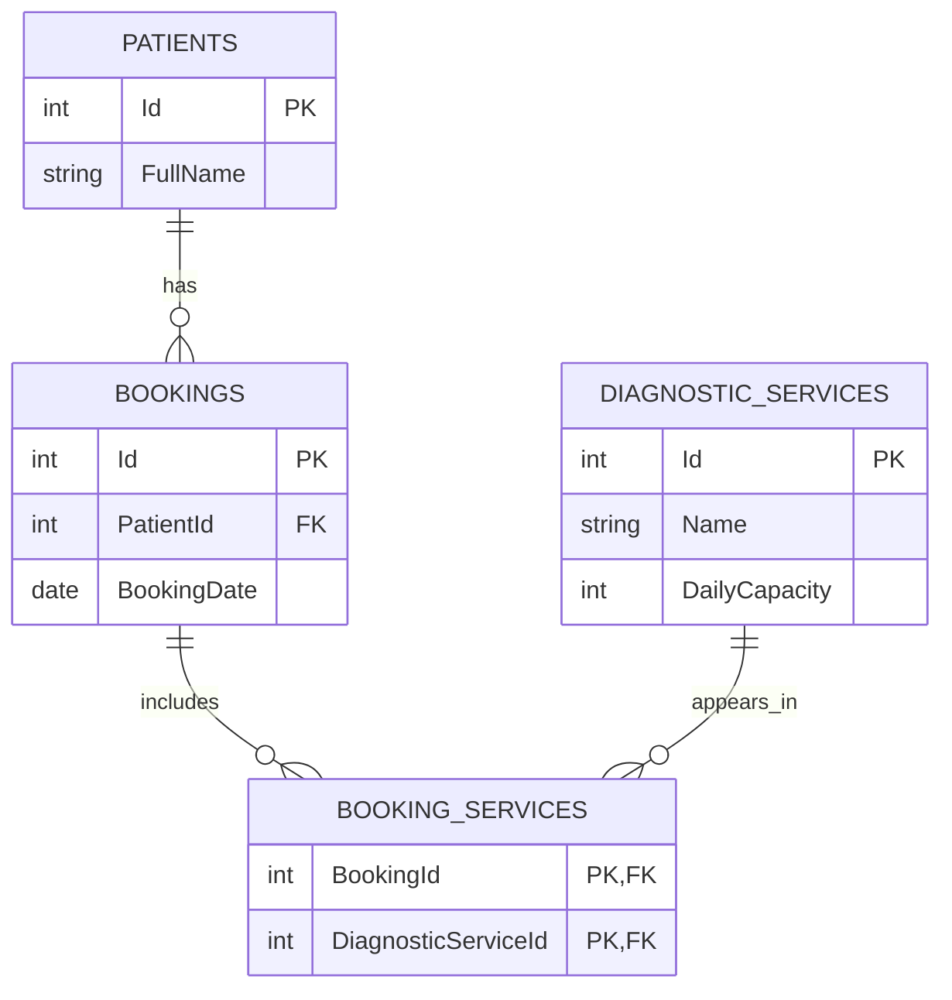

# CareFlow relational design

`BookingServices` links `Bookings` to `DiagnosticServices`. Its composite primary key prevents a duplicate service within a booking. The database permits zero or more linked rows during writes. The confirmation service requires one to three distinct services before committing a booking.

Each service has one daily capacity value. Remaining slots for a date are calculated from the booking-service links for that date. Confirmation reserves SQLite's writer before rechecking capacity and saves the booking and all its links in one transaction.

See [the EF Core mappings](../Data/CareFlowDbContext.cs) and [the initial migration](../Data/Migrations/20261116133123_InitialCreate.cs).
